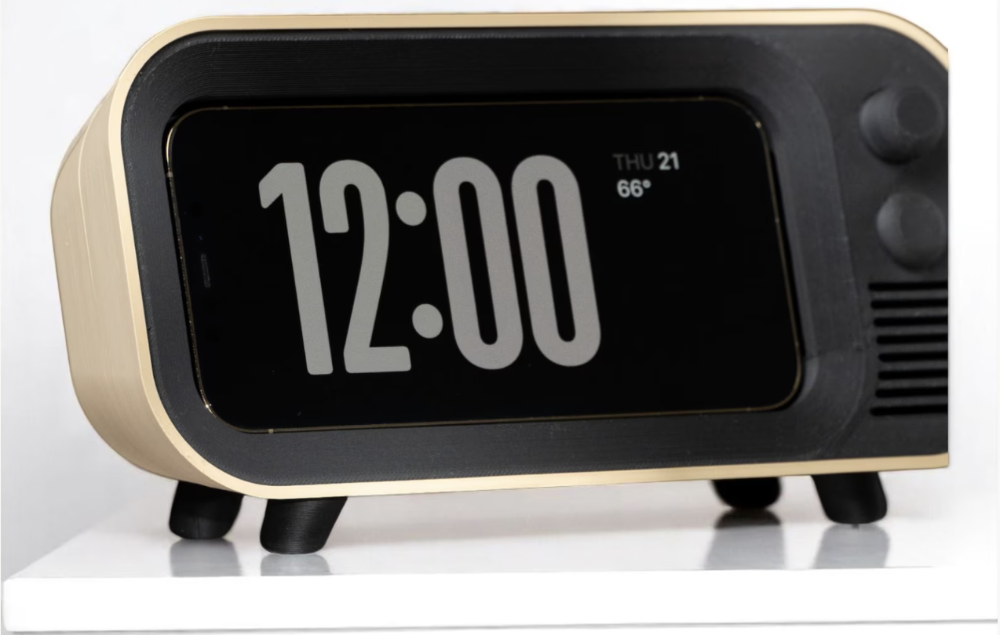

# Project Work by Week

## Week 5

### Dev board image and wifi connectivity

- installed podman
- attempted to flash sd card with debian image using BOARD=oz64
  - Didn't work
- installed duos-e_sd.img.lz4 and flashed sd card with that image
- Connected ethernet cable from computer to dev board
- The ethernet cable has a physical link, as in the status:active
  - However, we can't get an IP connection to the board yet. Still a
    work in progress. 

### Hardware acquiring

- Purchased an adapter ethernet connection on my laptop
- Placed orders for:
  - power cable
  - usb to ttl serial cable
  - antenna (wireless connection to dev board).
  
## Week 7

### Project Timeline

Created project timeline; breaks up project into two distinct segments:

- Software/Hardware -> Handling our logic and calendar synchronization
- Designing and Assembling an enclosure to house our project

### Code

Created a python file to demo some clock logic. Included a test file to test the functions in clock.py

### Reference Image for Final Project

Here's a reference image for the final project design

### Additonal updates

Things I've ordered off amazon this week to use in our project:
- PAM8403 Amplifiers
- SPI TFT LCD Display modules
- 3W 8Ω mini speakers
- 16mm colored push buttons